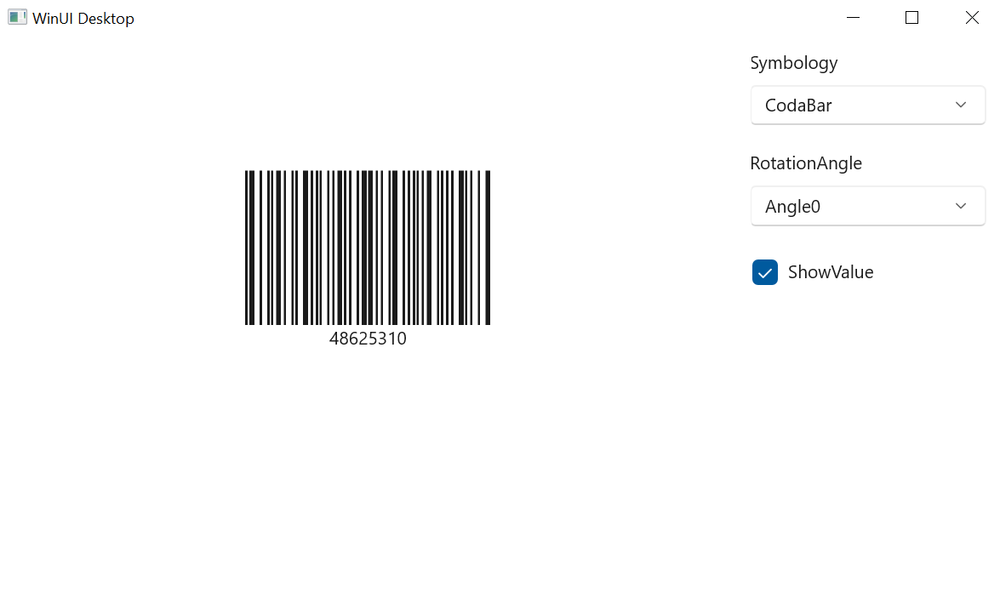

# GettingStarted Barcode WinUI
This is demo application of WinUI SfBarcode control. The minimal set of required properties have been configured in this project to get started with SfBarcode in WinUI.

## Description ##

The [SfBarcode](https://help.syncfusion.com/winui/barcode/getting-started) control helps you to generate and display data in a machine-readable format. It provides a perfect approach for encoding text using the supported barcode types.

## Initialize Barcode
Add reference to [Syncfusion.Barcode.WinUI](https://www.nuget.org/packages/Syncfusion.Barcode.WinUI) NuGet and import the control namespace `Syncfusion.UI.Xaml.Barcode`  in XAML or C# to initialize the control.

###### Xaml
```xaml

<Window
    .....
    xmlns:syncfusion="using:Syncfusion.UI.Xaml.Barcode">
    
    <syncfusion:SfBarcode Value="48625310">
        <syncfusion:SfBarcode.Symbology>
            <syncfusion:CodabarBarcode />
        </syncfusion:SfBarcode.Symbology>
    </syncfusion:SfBarcode>
            
</Window>
 ```
###### C#
```C#

using Syncfusion.UI.Xaml.Barcode;

namespace GettingStarted
{
    public sealed partial class MainWindow : Window
    {
        public MainWindow()
        {
            InitializeComponent();
            
            SfBarcode barcode = new SfBarcode();
            CodabarBarcode codabarBarcode = new CodabarBarcode();
            barcode.Symbology = codabarBarcode;
            barcode.Value = "48625310";
        }
    }   
}
```

## Switching Symbology

This sample demonstrates how to switch between different barcode symbologies at runtime. The sample uses a ViewModel to manage the symbology selection and binds it to the barcode control.

###### Xaml
```xaml
<Window
    x:Class="GettingStarted.MainWindow"
    xmlns="http://schemas.microsoft.com/winfx/2006/xaml/presentation"
    xmlns:x="http://schemas.microsoft.com/winfx/2006/xaml"
    xmlns:local="using:GettingStarted"
    xmlns:d="http://schemas.microsoft.com/expression/blend/2008"
    xmlns:mc="http://schemas.openxmlformats.org/markup-compatibility/2006"
    xmlns:syncfusion="using:Syncfusion.UI.Xaml.Barcode"
    xmlns:core="using:Syncfusion.UI.Xaml.Core"
    mc:Ignorable="d">

    <Grid>
        <Grid.DataContext>
            <local:ViewModel />
        </Grid.DataContext>
        <Grid.ColumnDefinitions>
            <ColumnDefinition Width="*" />
            <ColumnDefinition Width="Auto" />
        </Grid.ColumnDefinitions>
        <StackPanel Grid.Column="0"
                    Margin="0,100,0,0"
                    HorizontalAlignment="Center">
            <syncfusion:SfBarcode x:Name="barcode"
                                  Width="340"
                                  Height="150"
                                  Module="{Binding ModuleValue}"
                                  Symbology="{Binding SymbologyItem}"
                                  Value="48625310" />
        </StackPanel>
        <StackPanel Grid.Column="1"
                    Orientation="Vertical">
            <ComboBox x:Name="symbology"
                      Width="185"
                      Margin="10"
                      DisplayMemberPath="SymobologyItem"
                      Header="Symbology"
                      ItemsSource="{Binding Symbology}"
                      SelectedIndex="0"
                      SelectedItem="{Binding SelectedItem, Mode=TwoWay, UpdateSourceTrigger=PropertyChanged}" />
            <ComboBox x:Name="rotationAngle"
                      Width="185"
                      Margin="10"
                      Header="RotationAngle"
                      ItemsSource="{core:EnumValuesExtension Type=syncfusion:BarcodeRotation}"
                      SelectedItem="{Binding ElementName=barcode, Path=RotationAngle, Mode=TwoWay}" />
            <CheckBox x:Name="showValue"
                      Width="185"
                      Margin="12,10,10,10"
                      Content="ShowValue"
                      IsChecked="{Binding ElementName=barcode, Path=ShowValue, Mode=TwoWay}" />
        </StackPanel>
    </Grid>
</Window>
```

## Supported Symbologies

The SfBarcode control supports various symbology types. In this sample, you can switch between the following symbologies:
* CodaBar
* Code11
* Code32
* Code39
* Code39Extended
* Code93
* Code93Extended
* Code128A
* Code128B
* Code128C
* UpcBarcode
* DataMatrix
* QRBarcode

## Customization Options

The sample also demonstrates several customization options for the barcode:

### Module
The width ratio of the wide and narrow bars can be changed using the Module property.

### Rotation Angle
The barcode can be rotated in various angles using the RotationAngle property.

### Show Value
The visibility of the barcode text can be controlled using the ShowValue property.

## Output ##



For more details please refer this ug [Barcode](https://help.syncfusion.com/winui/barcode/getting-started/?utm_medium=listing&utm_source=github-examples).


